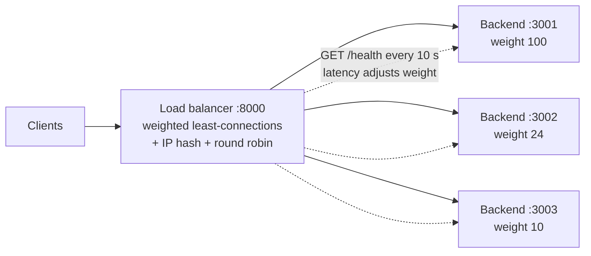

# Hybrid Load Balancer

A small HTTP load balancer in Node.js that picks a backend per request by combining three
strategies: **weighted least connections**, **IP-hash stickiness** and a **round-robin fallback**.
Backend weights adapt to measured latency, and unhealthy backends are taken out of rotation.


[](https://github.com/naksh1414/Load_Balancer/actions/workflows/ci.yml)

## How a backend is chosen

For every request, `getHybridServer(clientIp)` in [`load-balancer.js`](load-balancer.js):

1. **Filters to healthy backends.** If none are healthy, the request gets `503`.
2. **Finds the least-loaded backend** by the ratio `activeConnections / weight`.
3. **Tries IP-hash stickiness.** The client IP is hashed (MD5) to a preferred backend. That
   backend is used if its load ratio is within **20%** of the best one, so a client keeps hitting
   the same server unless it is noticeably busier.
4. **Falls back to round robin** across all backends whose load ratio is within **10%** of the
   best, spreading traffic evenly when several servers are equally free.
5. Otherwise it uses the least-loaded backend.

Active connections are incremented when a request is proxied and decremented when the
response finishes.

## Latency-aware weights and health checks

Every **10 seconds** each backend's `/health` endpoint is probed (1 s timeout):

- The measured latency adjusts the backend's effective weight:
  `weight = max(1, baseWeight × 100 / (latency + 1))`, so faster backends receive more traffic.
- A backend whose probe fails is marked unhealthy and skipped. It is brought back as soon as a
  later probe succeeds.

## Architecture



## Run it locally

Requires Node.js 18+.

```bash
git clone https://github.com/naksh1414/Load_Balancer.git
cd Load_Balancer
npm install

# start three example backends (separate terminals)
PORT=3001 node server.js
PORT=3002 node server.js
PORT=3003 node server.js

# start the load balancer on :8000
node load-balancer.js
```

Then send requests to `http://localhost:8000/` and watch the logs show which strategy chose
each backend.

## Tests

```bash
npm test
```

Unit tests in [`test/selection.test.js`](test/selection.test.js) use Node's built-in test runner
and need no running servers. They cover least-connections selection, skipping unhealthy
backends, round robin between equally loaded backends, IP-hash stickiness, moving a client off
an overloaded sticky backend, and health checks taking a backend out of rotation and bringing
it back. They run on every push via GitHub Actions.

With the backends and load balancer running, you can also run the end-to-end distribution test
and the metrics script:

```bash
npx mocha test_load_balancer.js
npm run metrics
```

## Project structure

| File | Purpose |
| --- | --- |
| `load-balancer.js` | Selection algorithm, health checks, proxying |
| `server.js` | Example backend with `/` and `/health` |
| `test/selection.test.js` | Unit tests for the selection algorithm and health checks |
| `test_load_balancer.js` | End-to-end distribution test (needs running servers) |
| `runMetricsTest.js` | Simple latency and throughput scoring script |

## Possible next steps

- Configure backends from environment or a service registry instead of a fixed list
- Per-client rate limiting backed by Redis
- Containerise with Docker Compose for one-command startup
- Concurrent load testing (e.g. autocannon or k6) for realistic throughput numbers

## Author

Nakshatra Manglik · [nakshatramanglik14@gmail.com](mailto:nakshatramanglik14@gmail.com) ·
[GitHub](https://github.com/naksh1414)
